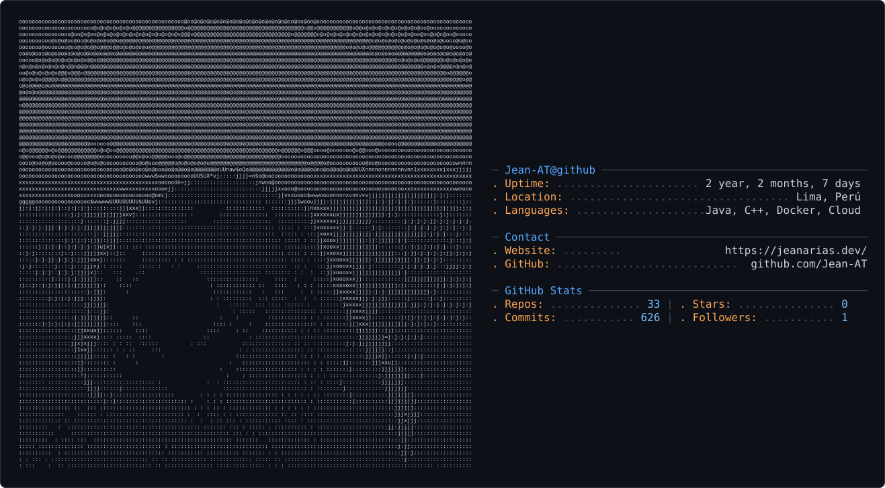

<picture>
  
</picture>

# Hi, I'm Jean  

I'm a **Software Engineering** at the **Peruvian University of Applied Sciences (UPC)**.  
I have growing experience in **backend development**, where I enjoy building APIs and structured systems using modern technologies.  

## Languages  

